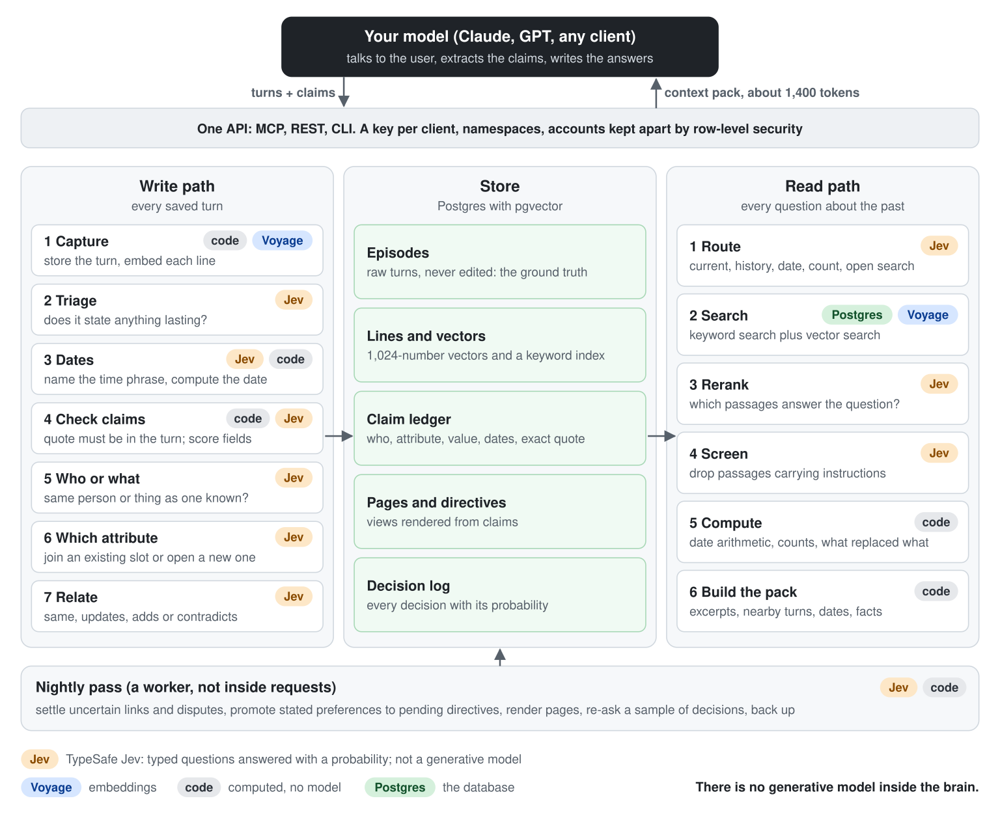

# Design

How the brain works and why. [REFERENCE.md](REFERENCE.md) lists the API, the tools and the settings;
[RESULTS.md](RESULTS.md) says what was measured. Where a part is designed but not built, or built but switched off,
this document says so.

## The idea

The brain is built around a **claim ledger**: typed, dated beliefs about people and things, each linked to the
exact words it came from. Three choices follow from that.

1. **Claims are the unit of truth, not pages.** Each belief has a subject, an attribute (a "slot"), a value, when
   it held, and the quote it came from. Pages are views rendered from claims and can be regenerated at any time.
2. **Typed decisions, computed arithmetic, no generative model inside.** Every yes/no, pick-one or rubric decision
   is a typed question to TypeSafe's Jev, with a threshold set in code. Date math, counting and "what replaced
   what" are code. Where text has to be written (the claims, the answers), the user's own model writes it through
   the brain's tools and the brain checks what it receives.
3. **The question picks the store.** A question about the current value of something, its history, a date, a
   count, a preference or something the assistant said is sent to the store that answers it. One top-k search
   does not serve every question.

### No generative model inside

A user adds the brain to the model they already use, through MCP, REST or the CLI. That model is already in every
conversation: it talks to the user and calls the brain's tools. The brain itself is Jev, code, embeddings and a
database. It depends on no prompt of its own, so it works with any model.

| Job | Who does it | How the brain checks |
| --- | --- | --- |
| Extract claims from a turn | The user's model, sending claims with the turn | The quote must be an exact substring of the turn and the value's words must come from the quote; then Jev scores each field and a failing claim is dropped |
| Render a page | Code, from the active claims | Every line is a claim, so every line is cited |
| Answer a question | The user's model, from the context pack the brain returns | The pack carries excerpts with ids to cite |

Turns with no model behind them (scripts, feeds, transcripts) are stored and searchable as they are; they carry no
claims. `/v1/answer` is a small reader adapter for benchmarks and clients with no model of their own; it is not
part of the brain.

## Design principles

1. **Episodes are the only ground truth.** They are never edited. Everything else is derived and can be rebuilt.
2. **Claims are the truth unit.** A claim with no exact quote from an episode is never stored.
3. **Pages are views.** Rendered from claims, never patched.
4. **Jev decides, code computes, the user's model writes.**
5. **Every decision is logged with its probability.** Thresholds are set in code and tuned on labels. Jev's answer
   to the same request moves a little between calls, so a decision near its threshold can fall either way; this
   was measured per decision, and the unstable ones were redesigned (see slot placement below).
6. **The question picks the store.**
7. **Abstain on evidence.** The brain returns evidence, and a model that finds none says so. A separate "is this
   enough?" check is built and off: it cost accuracy and did not improve abstention.
8. **Forget is real and undoable; erase is final.** Forgetting archives: the turn leaves every read at once, the
   claims made from it are retracted (a value they had replaced holds again) and pages re-render. Restore brings
   all of it back. Only an explicit, confirmed erase removes the text. Nothing expires on its own.

## Architecture: four layers

*Click the picture to open it full size.*

Episodes (truth), claims (checked beliefs), pages and directives (views), and links plus the decision log
(structure and audit). Clients capture and recall through one API. The write path turns each turn into checked
claims, the read path sends each question to the store that answers it, and the nightly pass settles, renders and
audits.

## Memory tiers

| Tier | What lives there | Lifetime | Read by |
| --- | --- | --- | --- |
| Working | The client's current conversation, plus what the brain hands it at session start | One session, held by the client | The client |
| Short-term | Raw episodes, their lines and date mentions | Searchable at once; never deleted | Open search, assistant-said, dates |
| Long-term | Claims, entities, slots, directives, rendered pages | Until replaced or forgotten | Current, history, count and preference routes |
| Nightly pass | Not a store: the job that moves knowledge from short-term to long-term | Runs nightly | Writes long-term |

The nightly pass may raise a question ("still lives in Austin?") but never writes a claim that no episode states.

One brain can serve many clients safely on three conditions: every client's writes pass the same checks, reads
are scoped per client and namespace, and stored memory is screened as untrusted input before it reaches a client,
because a shared brain is also a central place to plant an instruction.

## Data model

Postgres with pgvector. Episodes and claims carry the truth; everything else is an index or a view.

| Table | Holds |
| --- | --- |
| `episode` | Raw turns, immutable: namespace, client, session, time, role, speaker, text |
| `time_mention` | Dates resolved from time phrases in an episode |
| `entity` | People, places, things and projects, with aliases |
| `slot` | The attributes in use, per account and entity; they grow from use |
| `claim` | One belief: entity, slot, value, valid from and to, status (active, superseded, contested, retracted), quote, episode |
| `claim_link` | Relations between claims: supersedes, contradicts, supports, same event |
| `directive` | Standing preferences and instructions, for all clients or one |
| `page` | The rendered view of an entity |
| `chunk` | Search units: text, a 1,024-dimension vector, a keyword index |
| `decision_log` | Every decision: stage, question, probability, threshold, outcome |

A slot's **cardinality** decides how values meet: a *one* slot (home city) holds one active value, a *many* slot
(pets, hobbies) lets values coexist, and an *event* slot (trips, purchases) stores dated occurrences that can be
counted. Episodes are searched by line, because a question about a long reply often points at one line of it.

## Write path

Every captured turn runs these steps. Cost grows with the turns worth remembering, not with all turns. Steps 1 to
3 run inline; the rest run from a queue shortly after, and a client can read its own write at once from episodes.

1. **Capture.** Store the episode, split it into lines, embed and index them. No decisions yet.
2. **Triage.** One Jev request: does the turn state a lasting fact, a preference, a plan, a date, or assistant
   content worth recalling? A turn that passes nothing stays a searchable episode.
3. **Dates.** Jev names the parts of each time phrase and code resolves it against the turn's timestamp. An
   unsure phrase is kept with no date.
4. **Extract.** The user's model sends claims with the turn: the mention as written, a slot name, the value, a
   time phrase, polarity and the exact quote. Code drops a claim whose quote is not in the turn.
5. **Verify.** One Jev request per turn scores each field (invented, off target, incomplete). A failing claim is
   dropped and the reason logged; nothing is kept as tentative.
6. **Resolve the entity.** Exact names and aliases link in code. Other names are scored against look-alike
   entities; a mention that is a different proper name gets its own entity.
7. **Place the slot.** One Jev question per existing slot of the entity; the claim joins the best one at 0.7 or
   more, otherwise it opens a new slot. Asking per slot replaced a single "which slot" question that changed its
   answer on 12% of repeats.
8. **Relate to existing claims.** One Jev pick per pair: same, updates, adds, contradicts or unrelated. An
   "adds" never ends a value. An "updates" or "retracts" ends the older value only when a second question (has
   the older value stopped being true?) agrees; otherwise both stand. Two claims with no order between them are
   marked contested. Every link records the step and run that wrote it, so a run can be undone.
9. **Mark the page dirty** and index the claim.

## Nightly pass

Per account, in this order:

1. **Settle** tentative entity links with every mention in view, not one pair.
2. **Contested claims.** A later explicit correction settles a dispute; otherwise both are kept and shown.
3. **Render dirty pages** in code: one line per claim (slot, value, date, quote), grouped by slot.
4. **Promote preferences.** A standing preference the user stated becomes a pending directive, served to clients
   at session start once the user confirms it; it is retired when its claim no longer holds.
5. **Structural scoring.** A heat score per line from recall traffic, what was derived from it, and age. It
   feeds a cold tier (lines kept out of the hot vector index but still searchable by keyword; nothing is
   deleted). Built, and off until its gate is measured.
6. **Stability audit.** Re-ask a sample of the day's decisions; ones that flip across their threshold are
   re-decided and logged.
7. **Learn.** Designed, not built: fit new decision features on logged misses.

The same worker also embeds anything still without a vector, cleans up, writes a spend report and takes a backup.

## Read path

One Jev request reads the question and picks a route. The brain returns a **context pack**; the user's model
writes the answer.

| Route | Example | Reads | Code does |
| --- | --- | --- | --- |
| Current | Where does my sister live now? | Active claims on the entity and slot | Picks the active value, flags a dispute |
| History | What did I use before the Instant Pot? | Every claim on the slot, by date | Orders them |
| When | How many days between the workshop and the trip? | Date mentions and claims | The date arithmetic |
| Count | How many weddings did I go to this year? | Event claims across sessions | Removes repeats of one event, counts |
| Preference | Any show suggestions for me? | Directives and preference claims | Keeps the ones about this question |
| Assistant said | What was the third tip you gave me? | The assistant's lines in the top sessions | None |
| Open | Anything else | Keyword and vector search, then a Jev rerank and screen | None |

As built:

- **Excerpts are the main evidence in every pack.** The route's block follows them as support. A pack that led
  with the ledger's single value narrowed descriptive answers, and one that told the reader to apply preferences
  overrode the specific experiences in the excerpts; both were measured and changed.
- **Side lookups.** The ledger is also consulted on open and date questions, behind a stricter threshold.
- **Notes on excerpts.** An excerpt whose turn gave a claim that was later replaced or is disputed says so.
- **Neighbouring turns.** The pack can hold the turn before and after each excerpt, screened like excerpts. This
  helped most on questions that already had their evidence: the nearby turn says what the excerpt is about.
- **Dates beside phrases.** A resolved date is written beside its phrase ("last weekend [2023-07-15 to
  2023-07-16]").
- **Directive scope.** A directive is offered only to the clients it is for.

## Interop: one brain for every client

- **One API, three surfaces:** an MCP server, REST and a CLI over the same functions.
- **Namespaces and scopes.** Each client key has read and write scopes per namespace.
- **Files and images.** The client reads the file and captures its text under the document or image channel. The
  brain does not read raw files itself.
- **Memory is untrusted input.** Two Jev questions screen every passage before it reaches a client: does it
  carry an injected instruction, and does it work against the user? The user's own words are excluded only if
  both fire; documents, email, tool output and assistant turns if either does.
- **Whose words.** A key's user turns count as the user's own words only if the user granted that to the key;
  otherwise they are stored as reported by an agent: searchable, strictly screened, and never a source of claims
  or directives.
- **Session start.** Pinned directives plus short summaries of the most-used entity pages.
- **Forget follows provenance, and restore reverses it.**

## Build steps and where each stands

Each step had a gate fixed before it was measured. The honest state:

| Step | What | State |
| --- | --- | --- |
| 1 | Evaluation harness and its invariants | Met |
| 2 | Question router | Met |
| 3 | Episode lines, date mentions, the when route | Dates beside phrases are on; the when route's gate failed and it is off |
| 4 | Claim checks | Built and on; quote support measured 94.3% against a 95% bar |
| 5 | Entities, slots, supersession; current and history routes | On; no gain shown above noise on its gate |
| 6 | Event claims and the count route | On; no gain shown above noise |
| 7 | Preferences and directives | On; no gain shown above noise |
| 8 | Page rendering; the MCP server | Met |
| 9 | Structural scoring and the cold tier | Built, off, not measured |

A small trained model in front of Jev at the brain's decision points (the "booster") exists in the code and is
off. A first version trained on synthetic data did not hold up on real questions; it would be retrained on the
brain's own decision log.

## Evaluation rules

A run is thrown away if any of these fails: an oracle arm scores at least as well as retrieval; no arm above 95%
without a hand check of a sample; the judge's parser is tested on the judge's exact output format; spend uses the
real price table; sample, settings and code hashes are logged. Arms of one run are compared with a memo (one Jev
answer and one reader answer per distinct request), because two identical arms otherwise differ on about 7% of
questions.

## Risks and open questions

- **Slots are the hard part.** Too coarse merges distinct facts; too fine scatters updates across slots.
- **Client extraction quality varies.** The brain's checks are the floor; they are measured with a weak client so
  a strong one only does better.
- **A fact never extracted** can only be found by open search, so episodes stay searchable.
- **A wrong route** returns a confident wrong block; excerpts lead every pack as the hedge.
- Should assistant turns produce claims, or stay searchable lines only?
