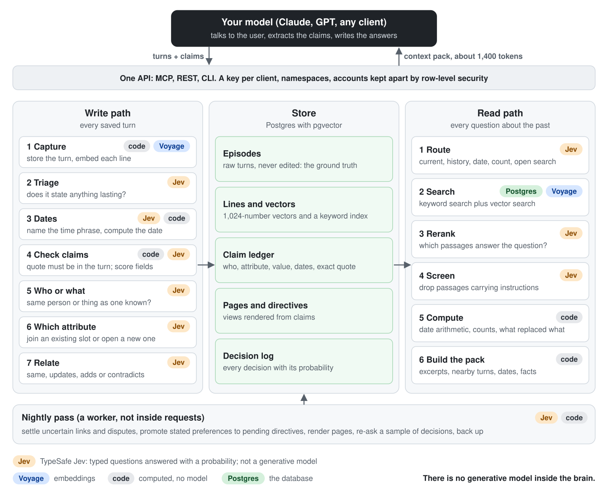

# Brain-Memory

**One memory for every model, session and bot you use.** Claude Code, Claude Desktop, a script, a bot on another
model: each connects with its own key and reads and writes the same memory, so what you tell one is known to
the others, in the next session and the one after.

It is a long-term memory service for any LLM. Your model keeps talking to you; the brain stores what was said,
checks the facts your model extracts, and hands back a small, dated, evidence-first context pack when a question
depends on the past. It runs behind REST, MCP and a CLI, on Postgres with pgvector.

New here? [SETUP.md](SETUP.md) takes you from a clone to a connected client, step by step.

## No generative model inside

The model you already use reads each turn, sends the claims it states, and writes the answers. The brain itself
is four things:

| Part | What it does |
| --- | --- |
| **[TypeSafe Jev](https://docs.typesafe.ai)** | Every judgment. Jev is not a generative model: it answers typed questions (yes or no with a probability, pick one of these, score against a rubric). Thresholds are set in code and every decision is logged. |
| **[Voyage](https://docs.voyageai.com) embeddings** | Meaning search. `voyage-4-lite` turns every stored line and every question into a 1,024-number vector, kept in pgvector. |
| **Code** | Everything that can be computed: date arithmetic, counting, what replaced what, rendering pages, building the context pack. |
| **Postgres with pgvector** | The store: turns, claims, the ledger, vectors, a keyword index, and a log of every decision. |

Because the brain depends on no prompt of its own, it works with any model, and a stronger model only does
better.

## How it works

*Click the picture to open it full size.* Each step carries a tag for who does it: Jev, Voyage, code or Postgres.

**Writing.** Your model saves a turn and sends the claims it states: who or what it is about, the attribute, the
value, and the exact sentence that says so. Code drops any claim whose quote is not in the turn. Jev scores what
is left, decides which person or thing it belongs to, which attribute it fills, and whether it replaces, adds to
or contradicts what was already known. A newer value ends an older one only when Jev also judges that the older
one has stopped being true.

**Reading.** Jev reads the question and picks a route (the current value of something, its history, a date, a
count, a preference, something the assistant said, or open search). Postgres keyword search and Voyage vector
search each propose candidates; Jev reranks them and screens every passage for injected instructions. Code builds
the pack: the best excerpts, the turn before and after each, resolved dates written beside relative phrases
("last weekend [2023-07-15 to 2023-07-16]"), and the ledger's own facts. Your model answers from it and cites the
excerpt ids.

**Nightly.** A worker re-checks uncertain links with every mention in view, settles disputes, turns stated
preferences into standing directives (pending until you confirm them), renders a page per person or thing,
re-asks a sample of the day's decisions, and takes a backup.

**Where Jev is asked.** Is this turn worth remembering; what a time phrase means; is each field of a claim
supported; is this the same person or thing; which attribute; same, updates, adds or contradicts; which route;
which passages answer the question; does a passage carry an instruction. Each is a typed question with a
threshold, never free text.

The full design, with the data model and the state of each build step, is in [DESIGN.md](DESIGN.md). Taking either
provider away costs about an eighth of the answers on one benchmark; what each use of Jev and Voyage was
measured to do is in [RESULTS.md](RESULTS.md#what-jev-and-voyage-each-do-and-what-was-measured).

## What it does

- **Capture.** Turns are stored with who said them, when, and through which client. Claims sent with a turn are
  checked against the turn's own words before they are kept.
- **A ledger of facts.** Checked claims are filed per person or thing and attribute. Corrections and
  disagreements are kept as such.
- **Recall and context.** A pack of about 1,400 tokens that any model can answer from.
- **Forget is real and undoable.** Forget archives and restore brings back; a confirmed erase is final. Nothing
  expires on its own.
- **Many clients, one brain.** One key per client; accounts are kept apart by Postgres row-level security.
- **Memory is untrusted input.** Every passage is screened before it reaches a model, and a directive a client
  proposes stays pending until the user confirms it.
- **Spend is capped.** A daily cap in dollars; when it is reached or a provider is down, the service degrades
  (search without rerank, text stored without a vector) instead of failing.

## What you can use it for

| Use | What it relies on | How far it is tested |
| --- | --- | --- |
| **An assistant that remembers you across sessions.** It starts each session with your standing instructions, saves what you state, and looks things up before answering | Capture, the context pack, session start | Measured on two benchmarks and six professional domains ([RESULTS.md](RESULTS.md)) |
| **One memory shared by several tools and models.** Claude Code, Claude Desktop, a script and a bot on another model each get their own key and read and write the same memory | A key per client, namespaces, per-client directives | Checked with two clients on one hosted brain: what one saved, the other found. Many clients writing at the same moment is not yet measured |
| **A bot with a separate memory for each of its users.** One account per user, kept apart in the database | Accounts and row-level security | Isolation tested with 30 accounts under random concurrent load; no public bot has run on it |
| **Memory you can audit and undo.** Every stored fact carries the sentence it came from, every decision is logged with its probability, and anything can be forgotten and restored | Quotes on claims, the decision log, forget and restore | Tested; see the design principles in [DESIGN.md](DESIGN.md) |

It is not a fit, today, for a voice assistant that needs an answer in well under a second (a context pack takes
about 0.8 s), or for a client that cannot call tools.

## How well it works

Measured with a low-end client (Claude Haiku) and a stronger reader (Claude Sonnet). "Retrieval alone" is the
brain's own search with the upper layers off; it is not a model without memory.

| Material | Reader | Full pack | Retrieval alone |
| --- | --- | --- | --- |
| LoCoMo, all 1,540 questions | Haiku | 77.3% | 73.5% |
| LoCoMo, all 1,540 questions | Sonnet | 83.9% | 80.8% (no memory: 14.6%) |
| LongMemEval, 131 held-out questions | Haiku | 82.4% | 70.2% |
| LongMemEval, 131 held-out questions | Sonnet | 90.8% | 83.2% (no memory: 6.9%) |
| Six professional domains, 150 questions | Haiku | 94.0% | 89.3% |
| Six professional domains, 150 questions | Sonnet | 94.7% | 92.0% |

Answers on early material held as a memory grew eightfold. Storing a turn costs $0.14 per 1,000 and a question
about a tenth of a cent; a context pack takes about 0.8 s. [RESULTS.md](RESULTS.md) has the methods, the parts
measured on their own (two missed their bar and are reported so), speed and load, and the limits.

**Known limits.** Counting things spread over many sessions is the weak question type. A client that sends no
claims gets retrieval only. The ledger follows about a third of changed facts today, and answers do not yet
depend on it. Nothing improves with use yet.

## How to use it

[SETUP.md](SETUP.md) is the step-by-step guide, including connecting several clients to one memory and what to do
when something is wrong. The outline:

### 1. Run the service

You need Python 3.12 and a Postgres database with the `vector` extension. The brain calls two outside services,
and you bring your own key for each:

| Key | From | Used for | Without it |
| --- | --- | --- | --- |
| `TYPESAFE_API_KEY` | [TypeSafe](https://docs.typesafe.ai) | Jev: every judgment (check claims, file them, route a question, rerank, screen) | Search still works, with no rerank, no router and no screen (`degraded: "no_rerank"`); claims are not checked or filed |
| `VOYAGE_API_KEY` | [Voyage AI](https://docs.voyageai.com) | Embeddings: one vector per stored line and per question | Text is stored and found by keyword only (`degraded: "no_embed"`); the worker adds vectors once a key is set |
| `ANTHROPIC_API_KEY` | Anthropic | Only `/v1/answer`, the reader for clients with no model of their own | Everything else works; your own model answers from the context pack |
| `BRAIN_ADMIN_KEY` | You: a long random secret | The operator's key: creates accounts and client keys | No one can create accounts or client keys |

What it costs to run, measured: about $0.14 per 1,000 turns stored and about a tenth of a cent per question, nearly
all of it Jev. `BRAIN_DAILY_CAP_USD` (default 5) stops spending for the day when it is reached. To try the service
with no keys at all, set `BRAIN_OFFLINE=1`: both providers become deterministic stubs, which is how the tests run.

**The quickest start: Docker, and nothing else to install.**

    git clone https://github.com/jmurray10/brain-memory && cd brain-memory/service
    docker compose run --rm setup                 # writes .env: an operator key, and trial mode if you have no keys yet
    docker compose up -d --build                  # the database, the API on http://localhost:8000, and both workers
    docker compose run --rm setup                 # creates a client key and prints how to connect

The last command shows the key once, the line that connects Claude Code, and the block to paste into Claude
Desktop's config. Nothing needs scheduling: Compose runs the write path every ten minutes and the nightly pass
once a day. For real answers put `TYPESAFE_API_KEY` and `VOYAGE_API_KEY` in `service/.env` and set
`BRAIN_OFFLINE=0`. [SETUP.md](SETUP.md) walks through every step.

**Or run it without Docker**, against your own Postgres:

    git clone https://github.com/jmurray10/brain-memory && cd brain-memory/service
    python -m venv .venv && .venv/bin/pip install -r requirements.txt
    cp .env.example .env            # set DATABASE_URL, BRAIN_ADMIN_KEY, VOYAGE_API_KEY, TYPESAFE_API_KEY
    python -m brain.serve           # applies migrations, serves on :8000; OpenAPI at /docs

Turn the upper layers on in `.env`: `WRITE_PATH_ENABLED=1` keeps the claims clients send and builds the ledger,
and `BRAIN_LEDGER_ROUTE=1` uses the router and the ledger in the context pack. Without them the brain is storage
and search. [REFERENCE.md](REFERENCE.md) lists every setting and which ones are measured on.

### 2. Give each client its own key

    export BRAIN_KEY=$BRAIN_ADMIN_KEY
    python -m brain.cli admin create-client claude-code --read me --write me --default me --speaks-as-user

The key is printed once. `me` is a namespace: one partition of your memory. `--speaks-as-user` says this client's
user turns are your own words; without it they are stored as reported by an agent and file no claims.

### 3. Connect your model

Over MCP (any client that speaks streamable HTTP):

    claude mcp add --transport http brain http://localhost:8000/mcp --header "Authorization: Bearer $KEY"

Claude Desktop speaks stdio, so it runs the proxy. Add this to `claude_desktop_config.json` (Settings, Developer,
Edit Config) and restart Claude Desktop; the memory tools then appear in every chat:

    {
      "mcpServers": {
        "brain": {
          "command": "docker",
          "args": ["run", "-i", "--rm", "--add-host", "host.docker.internal:host-gateway",
                   "-e", "BRAIN_URL", "-e", "BRAIN_KEY", "brain-memory", "python", "-m", "brain.mcp_stdio"],
          "env": {
            "BRAIN_URL": "http://host.docker.internal:8000",
            "BRAIN_KEY": "bk_..."
          }
        }
      }
    }

`docker compose run --rm setup` prints this block with your key already in it. Give Claude Desktop its own key,
not the one another client uses. Without Docker, the command is the Python of your virtual environment with
`-m brain.mcp_stdio` (see [service/README.md](service/README.md)). The tools describe themselves, so the model
needs no extra prompt:

| Tool | When the model calls it |
| --- | --- |
| `memory_session_start` | Once at the start: standing directives and summaries of the most-used pages |
| `memory_capture` | When you say something worth remembering. Its description carries the contract for the claims to send |
| `memory_context` | Before answering a question that depends on the past |
| `memory_recall` | Plain passage search |
| `memory_current`, `memory_history`, `memory_page` | The ledger's current value, an attribute's timeline, a person or thing's page |
| `memory_forget`, `memory_restore` | Archive and undo. There is no erase tool, so a model cannot erase by mistake |

### 4. Or call it over REST

Save a turn with the claim it states:

    curl -H "Authorization: Bearer $KEY" -H 'content-type: application/json' localhost:8000/v1/capture -d '{
      "namespace": "me",
      "turns": [{
        "role": "user",
        "text": "My sister moved to Austin last month.",
        "claims": [{
          "mention": "My sister", "slot": "new:home_city", "value": "Austin",
          "time_phrase": "last month", "polarity": "asserted",
          "quote": "My sister moved to Austin last month."
        }]
      }]
    }'

Ask for the context pack and hand its `prompt` to your model:

    curl -H "Authorization: Bearer $KEY" -H 'content-type: application/json' localhost:8000/v1/context \
      -d '{"namespace": "me", "question": "Where does my sister live?"}'

A turn sent with no claims is still stored and searchable.

### 5. Or use the CLI

    python -m brain.cli capture "My sister lives in Austin." -n me
    python -m brain.cli recall "Where does my sister live?" -n me
    python -m brain.cli forget --episode 12 -n me
    python -m brain.cli admin restore --episode 12 -n me
    python -m brain.cli export --format jsonl --out me.jsonl -n me

### 6. Schedule the worker

The write path and the nightly pass run from a worker, not inside requests. Docker Compose runs both for you.
Anywhere else, use a scheduler, or `--every SECONDS` in place of `--once` to have the worker repeat on its own:

    python -m brain.worker --once --steps write_path,embed_backfill    # every ten minutes
    python -m brain.worker --once                                      # every step, once a night

More in [service/README.md](service/README.md): accounts, directives, backups, the whole-account export.

## Tests

    cd service
    export TEST_DATABASE_URL=postgresql://...     # an empty database you can throw away: the tests recreate schema `brain`
    BRAIN_OFFLINE=1 python -m pytest -q

They need no keys and make no paid calls.

## Documents

- [SETUP.md](SETUP.md): set it up and connect your clients, step by step.
- [DESIGN.md](DESIGN.md): the brain's design: write path, ledger, read routes, nightly pass.
- [REFERENCE.md](REFERENCE.md): the API, the MCP tools, keys and accounts, every setting.
- [RESULTS.md](RESULTS.md): what was measured and how.
- [EXPERIMENT-LOG.md](EXPERIMENT-LOG.md): every experiment, with the bar set before its run and what happened,
  including the ones that failed.
- [HARNESS.md](HARNESS.md): the faults found in the evaluation harness, and the rules every run has to pass.
- [DATA.md](DATA.md): the benchmark data, which is not in this repository.
- [CONTRIBUTING.md](CONTRIBUTING.md): the rules a change has to keep.
- [SECURITY.md](SECURITY.md): what the service protects, and how to report a problem privately.
- [CHANGELOG.md](CHANGELOG.md): notable changes.

## Contact

Built by **Jeff Murray** ([@jmurray10](https://github.com/jmurray10)).

- Email: **jeff.murray@alumni.upenn.edu**
- LinkedIn: [linkedin.com/in/jeff-murray-ai](https://www.linkedin.com/in/jeff-murray-ai)
- GitHub: [@jmurray10](https://github.com/jmurray10)

Security problems go through private vulnerability reporting instead ([SECURITY.md](SECURITY.md)).

## Licence

MIT (see [LICENSE](LICENSE)). The benchmark data is not covered by it and is not in this repository
([DATA.md](DATA.md)). Using TypeSafe's and Voyage's APIs is subject to their own terms.
